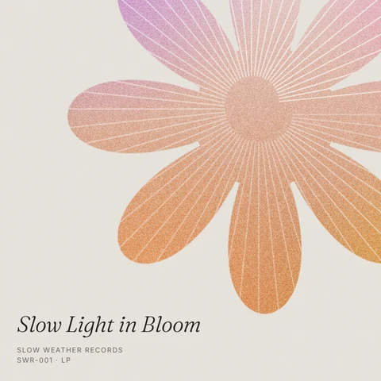
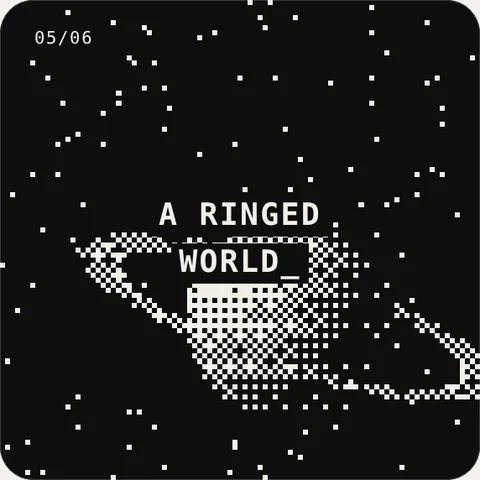
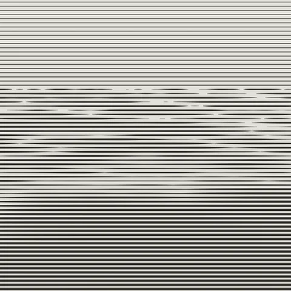
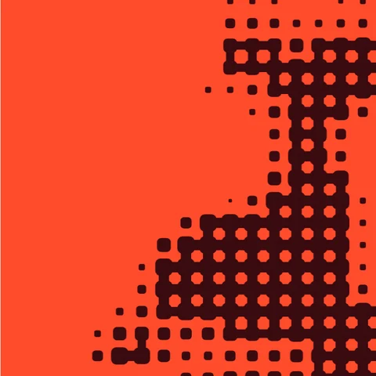
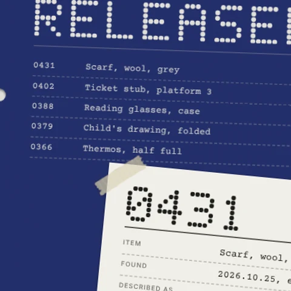
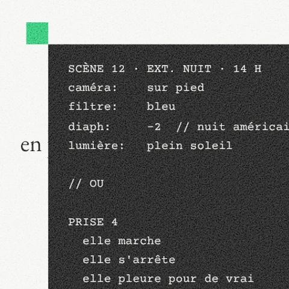

<div align="center">

# tiny-consoles

Small design experiments, collected over time.<br>
Each one is a Web Component you can drop into any page with a single tag.

**[Open the live gallery →](https://tinyconsoles.vercel.app/)**

</div>

<br>

## Card sets

Six small pieces side by side, each one alive on its own.

<table>
<tr>
<td width="112"><a href="https://tinyconsoles.vercel.app/#soft-grain"></a></td>
<td><b>01 · <a href="https://tinyconsoles.vercel.app/#soft-grain"><code>&lt;soft-grain&gt;</code></a></b><br>Six record sleeves for an imagined quiet label; grainy gradients cut into shapes, fine lines that ripple.<br><sub>grain · record sleeve · line art · <a href="components/soft-grain/assets/preview.webp">preview</a> · <a href="components/soft-grain/DESIGN.md">design notes</a></sub></td>
</tr>
<tr>
<td width="112"><a href="https://tinyconsoles.vercel.app/#deep-space"></a></td>
<td><b>02 · <a href="https://tinyconsoles.vercel.app/#deep-space"><code>&lt;deep-space&gt;</code></a></b><br>Six tiny 1-bit screens, live-dithered at 30 fps, with parallax under the cursor.<br><sub>1-bit · dither · generative · <a href="components/deep-space/assets/preview.webp">preview</a> · <a href="components/deep-space/DESIGN.md">design notes</a></sub></td>
</tr>
</table>

## Identity boards

One wide board for an imagined place, drawn entirely in code.

<table>
<tr>
<td width="112"><a href="https://tinyconsoles.vercel.app/#soundings-board"></a></td>
<td><b>03 · <a href="https://tinyconsoles.vercel.app/#soundings-board"><code>&lt;soundings-board&gt;</code></a></b><br>A coastal listening station: seabed sections, a card on a grid, a depth readout that surfaces words.<br><sub>identity · swiss grid · engraving · <a href="components/soundings-board/assets/preview.webp">preview</a> · <a href="components/soundings-board/DESIGN.md">design notes</a></sub></td>
</tr>
<tr>
<td width="112"><a href="https://tinyconsoles.vercel.app/#rerun-board"></a></td>
<td><b>04 · <a href="https://tinyconsoles.vercel.app/#rerun-board"><code>&lt;rerun-board&gt;</code></a></b><br>An institute of reruns: colonies grow in, the clock counts down, and everything grows back almost the same.<br><sub>identity · liquid pixels · loop · <a href="components/rerun-board/assets/preview.webp">preview</a> · <a href="components/rerun-board/DESIGN.md">design notes</a></sub></td>
</tr>
</table>

## Paperwork

Sheets of invented documents that write and reveal themselves. Click a sheet to see it full size.

<table>
<tr>
<td width="112"><a href="https://tinyconsoles.vercel.app/#lost-and-found"></a></td>
<td><b>05 · <a href="https://tinyconsoles.vercel.app/#lost-and-found"><code>&lt;lost-and-found&gt;</code></a></b><br>Four sheets from a lost property register that type themselves in, then get highlighted and stamped.<br><sub>archive · forms · dot type · stamp · <a href="components/lost-and-found/assets/preview.webp">preview</a> · <a href="components/lost-and-found/DESIGN.md">design notes</a></sub></td>
</tr>
<tr>
<td width="112"><a href="https://tinyconsoles.vercel.app/#day-for-night"></a></td>
<td><b>06 · <a href="https://tinyconsoles.vercel.app/#day-for-night"><code>&lt;day-for-night&gt;</code></a></b><br>Four sheets of French New Wave paperwork whose English subtitles do not quite agree.<br><sub>new wave · subtitles · grain · <a href="components/day-for-night/assets/preview.webp">preview</a> · <a href="components/day-for-night/DESIGN.md">design notes</a></sub></td>
</tr>
</table>

<br>

## Use a piece

Two lines: the script, then the tag. Swap `day-for-night` for any piece above.

```html
<script type="module" src="https://nonsenseblue.github.io/tiny-consoles/components/day-for-night/src/day-for-night.js"></script>
<day-for-night></day-for-night>
```

### With React

Every piece also comes as a typed React component that renders the same Web Component.

```sh
npm install github:nonsenseblue/tiny-consoles
```

```jsx
import { SoftGrain, DeepSpace, SoundingsBoard, RerunBoard, LostAndFound, DayForNight } from 'tiny-consoles/react';

export default function Page() {
  return <DayForNight style={{ maxWidth: 960 }} />;
}
```

Sources are in [`react/src/`](react/src). Each component loads its piece in the browser only, so server rendering is safe. Tested with Vite, TypeScript and React 19.

<br>

## How it is built

- **No dependencies, no build step.** Each piece loads the stylesheet next to it from its own URL, so the one-line embed works anywhere.
- **Isolated.** Styles live inside Shadow DOM; nothing leaks in or out.
- **Sized by its container**, not the page, so it fits wherever it is placed.
- **Calm by default.** Motion stops when `prefers-reduced-motion` is set.
- **One folder per piece.** Add a folder and one entry in [`pieces.json`](pieces.json), and the gallery builds itself.

```
components/<tag>/
  DESIGN.md            design notes, tokens and influences
  src/<tag>.js         the Web Component
  src/<tag>.css        its styles
  assets/thumb.webp    the small still in the gallery and here
  assets/preview.webp  the full preview image
```

## License

Code: [MIT](LICENSE). Visual designs and images: [CC BY 4.0](https://creativecommons.org/licenses/by/4.0/), please credit **nonsenseblue**.

<br>

<div align="center"><sub>Made by <a href="https://github.com/nonsenseblue">nonsenseblue</a> with Claude</sub></div>
