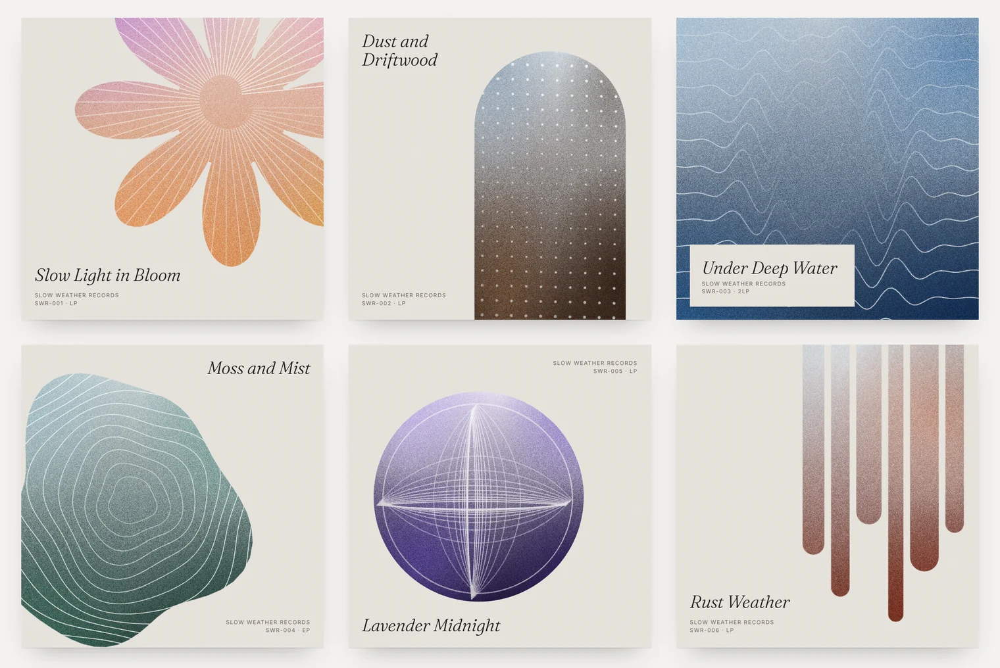
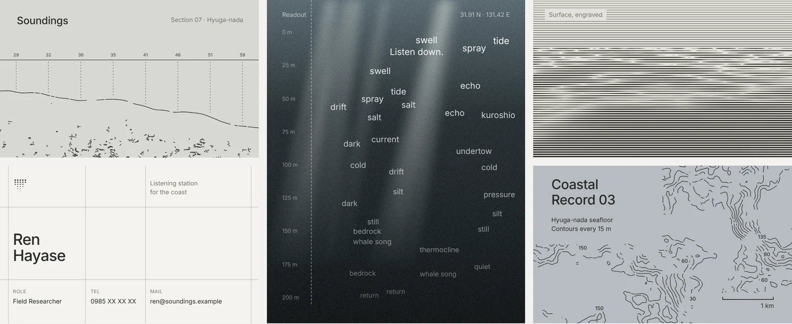
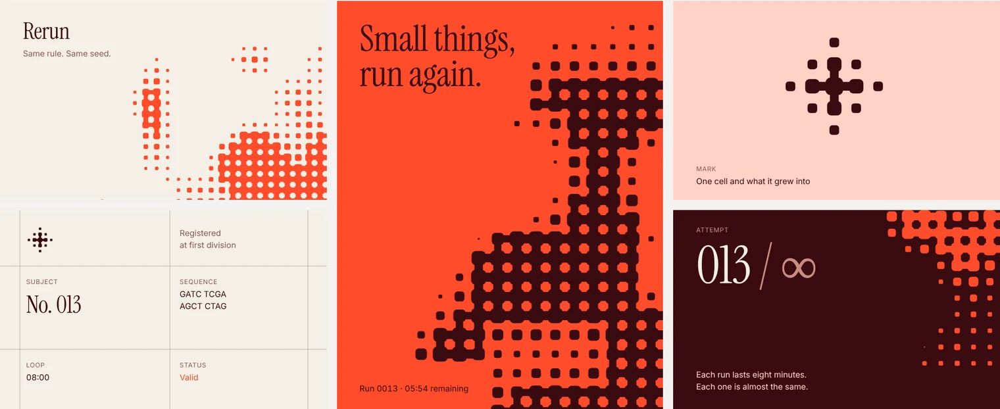

<div align="center">

# tiny-consoles

Small design experiments, collected over time.<br>
Each one is a Web Component you can drop into any page with a single tag.

**[Open the live gallery →](https://nonsenseblue.github.io/tiny-consoles/)**

</div>

<br>

## 01 · `<soft-grain>`

<a href="https://nonsenseblue.github.io/tiny-consoles/#soft-grain"></a>

Six grainy gradient covers. Fine line patterns draw themselves in, a slow brightness wave travels along them, and on hover the motion ripples outward line by line.

```html
<script type="module" src="https://nonsenseblue.github.io/tiny-consoles/components/soft-grain/src/soft-grain.js"></script>
<soft-grain></soft-grain>
```

Design notes: [`components/soft-grain/DESIGN.md`](components/soft-grain/DESIGN.md)

<br>

## 02 · `<deep-space>`

<a href="https://nonsenseblue.github.io/tiny-consoles/#deep-space"></a>

Six tiny 1-bit screens. Every scene is live-dithered through an 8×8 Bayer matrix at 30 fps, with spring parallax under the cursor.

```html
<script type="module" src="https://nonsenseblue.github.io/tiny-consoles/components/deep-space/src/deep-space.js"></script>
<deep-space></deep-space>
```

Design notes: [`components/deep-space/DESIGN.md`](components/deep-space/DESIGN.md)

<br>

## 03 · `<soundings-board>`

<a href="https://nonsenseblue.github.io/tiny-consoles/#soundings-board"></a>

An identity board for an imagined coastal listening station. Seabed sections, a card on a visible grid and a depth readout that surfaces words on the way down, all drawn in code.

```html
<script type="module" src="https://nonsenseblue.github.io/tiny-consoles/components/soundings-board/src/soundings-board.js"></script>
<soundings-board></soundings-board>
```

Design notes: [`components/soundings-board/DESIGN.md`](components/soundings-board/DESIGN.md)

<br>

## 04 · `<rerun-board>`

<a href="https://nonsenseblue.github.io/tiny-consoles/#rerun-board"></a>

An identity board for an imagined institute that runs the same small life again and again. Colonies of cells grow in, the clock counts down, and at zero everything grows back almost the same.

```html
<script type="module" src="https://nonsenseblue.github.io/tiny-consoles/components/rerun-board/src/rerun-board.js"></script>
<rerun-board></rerun-board>
```

Design notes: [`components/rerun-board/DESIGN.md`](components/rerun-board/DESIGN.md)

<br>

## Notes

- **No dependencies, no build step.** Each piece is one folder in [`components/`](components). Each component loads the stylesheet next to it, resolved from its own URL, so the one-line embed keeps working anywhere.
- **One folder per piece.** Everything a piece needs sits together. To add a piece, add a folder like this and one entry to [`pieces.json`](pieces.json); the gallery builds itself from that list.

  ```
  components/<tag>/
    DESIGN.md        design notes, tokens and influences
    src/<tag>.js     the Web Component
    src/<tag>.css    its styles, loaded by the component
    assets/thumb.webp    the small still in the index
    assets/preview.webp  the image in this README
  ```
- **Responsive.** Cards reflow from three columns to two to one based on the width of the element, not the page.
- **Calm by default.** All motion stops when `prefers-reduced-motion` is set.
- **Isolated.** Styles live inside Shadow DOM, so nothing leaks in or out.

## License

Code is released under the [MIT License](LICENSE).
Visual designs and preview images are licensed under [CC BY 4.0](https://creativecommons.org/licenses/by/4.0/). Please credit **nonsenseblue** when sharing.

<br>

<div align="center"><sub>Made by <a href="https://github.com/nonsenseblue">nonsenseblue</a> with Claude</sub></div>
