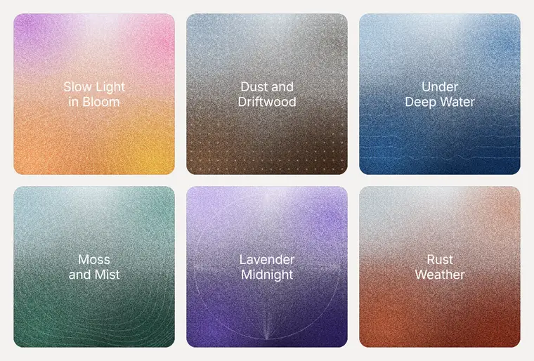
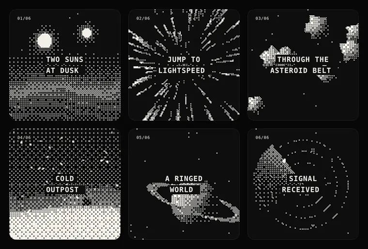

<div align="center">

# tiny-consoles

Small design experiments, collected over time.<br>
Each one is a Web Component you can drop into any page with a single tag.

**[Open the live gallery →](https://nonsenseblue.github.io/tiny-consoles/)**

</div>

<br>

## 01 · `<soft-grain>`

<a href="https://nonsenseblue.github.io/tiny-consoles/#soft-grain"></a>

Six grainy gradient covers. Fine line patterns draw themselves in, a slow brightness wave travels along them, and on hover the motion ripples outward line by line.

```html
<script type="module" src="https://nonsenseblue.github.io/tiny-consoles/components/soft-grain.js"></script>
<soft-grain></soft-grain>
```

<br>

## 02 · `<deep-space>`

<a href="https://nonsenseblue.github.io/tiny-consoles/#deep-space"></a>

Six tiny 1-bit screens. Every scene is live-dithered through an 8×8 Bayer matrix at 30 fps, with spring parallax under the cursor.

```html
<script type="module" src="https://nonsenseblue.github.io/tiny-consoles/components/deep-space.js"></script>
<deep-space></deep-space>
```

<br>

## Notes

- **No dependencies, no build step.** Each component is one self-contained file in [`components/`](components).
- **Responsive.** Cards reflow from three columns to two to one based on the width of the element, not the page.
- **Calm by default.** All motion stops when `prefers-reduced-motion` is set.
- **Isolated.** Styles live inside Shadow DOM, so nothing leaks in or out.

## License

Code is released under the [MIT License](LICENSE).
Visual designs and preview images are licensed under [CC BY 4.0](https://creativecommons.org/licenses/by/4.0/). Please credit **nonsenseblue** when sharing.

<br>

<div align="center"><sub>Made by <a href="https://github.com/nonsenseblue">nonsenseblue</a> with Claude</sub></div>
